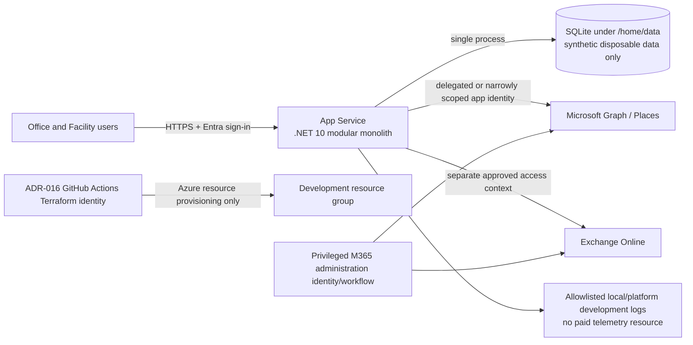

# Infrastructure Architecture Discovery

**Status:** Draft assessment; no hosting, identity, database, network, or production decision is approved.

**Date:** 2026-10-31

## Scope and repository evidence

This assessment prepares the infrastructure decision phase. It does not authorize resource creation, Microsoft Entra or Microsoft 365 permissions, database provisioning, application deployment, or Terraform apply. ADR-016 remains the only accepted architecture decision.

The repository contains no application source project and no Terraform `resource` blocks. The current Terraform configuration manages no Azure, Entra, database, or application resource:

| File/block | Actual effect |
|---|---|
| `versions.tf` | Pins Terraform 1.16.1, AzureRM `~> 4.0`, AzureAD 3.10.0, and declares the OIDC/Entra-authenticated Azure Blob backend. |
| `providers.tf` | Configures AzureRM and AzureAD with OIDC; declares tenant/subscription variables. |
| `data.azurerm_client_config.current` | Read-only discovery of the active Azure identity context. |
| `check.confirmed_identity` | Rejects a tenant or subscription mismatch. |

The bootstrap scripts create or configure the delivery foundation outside Terraform: remote-state resources, the dedicated deployment application/service principal and federated credential, scoped RBAC, and GitHub configuration. These are existing delivery prerequisites, not application infrastructure managed by the current Terraform configuration. They must not be duplicated in future modules.

Repository requirements support a .NET 10 ASP.NET Core modular monolith with Blazor, Microsoft Entra sign-in, Microsoft Graph/Places and Exchange integration, relational persistence only for supplementary data, privacy controls for visitor records, and structured observability. Microsoft Places and Exchange remain authoritative for workplace structures and booking decisions.

## Architecture recommendation pending approval

For the development proof of concept, use one Linux App Service **F1 Free** application with an embedded **SQLite** database. Do not provision an Azure database service, VNet integration, private endpoints, Key Vault, Application Insights, Log Analytics, NAT Gateway, firewall, Front Door, paid DNS, or any paid App Service SKU. If a required capability cannot run within those limits, host it locally or on existing on-premises infrastructure instead of selecting a paid Azure resource.

This is a cost-constrained proof-of-concept topology, not a production baseline. App Service F1 is limited to shared compute and 60 CPU minutes per day, has no SLA, and is intended for trials and experimentation. The SQLite file is acceptable only for synthetic, disposable development data and a single application instance.

This recommendation is conditional on approval of ADR-001, ADR-003, ADR-009, ADR-010, ADR-013 and ADR-015 and on a capability proof of concept. It is not an approved architecture or a Terraform implementation instruction.

The F1 development web endpoint is public and must be protected by single-tenant Entra authentication, HTTPS and application authorization. SQLite removes the database network endpoint entirely. Store the file under `/home/data`, never in the deployed application directory or temporary local storage. If the persistence and locking limitations are unacceptable, run the application and SQLite locally/on-premises; do not silently introduce a paid Azure database.

## Hosting alternatives

| Criterion | Azure App Service | On-premises IIS or container host |
|---|---|---|
| .NET 10 fit | Native Linux and Windows App Service support; managed platform. | Supported through IIS and the .NET Hosting Bundle or a managed container runtime. |
| Operations | Azure patches platform/OS; built-in scale, health, deployment and monitoring integrations. Application/runtime configuration remains the team's responsibility. | Organization owns host procurement, OS/runtime/IIS patching, capacity, load balancing, certificates, backup, monitoring and disaster recovery. |
| Identity | Managed identity eliminates Azure dependency credentials. User sign-in still needs an Entra application and application authorization. | Managed identity is unavailable outside Azure. Use a service principal with certificate, or separately approved workload federation where a suitable external OIDC issuer exists. |
| Microsoft 365 connectivity | Direct outbound HTTPS to Entra/Graph/Exchange; egress restrictions must retain required endpoints. | Requires reliable outbound HTTPS, proxy/firewall compatibility, DNS and certificate-chain access. |
| Private dependencies | Regional VNet integration provides outbound access; private endpoints provide inbound access to PaaS dependencies. Inbound App Service private access is a separate feature. | Direct LAN access can be simpler for existing internal systems, but DMZ segmentation and inbound publishing become customer responsibilities. |
| Deployment | Platform deployment APIs and slots; Standard tier or higher is needed for slots. A future application-delivery workflow is still required. | Requires an approved agent, artifact transfer, server access and rollback mechanism. Current ADR-016 covers Terraform, not application deployment to IIS. |
| Availability | Single-instance development is simple; production scale, zones and multi-region design remain open. | Depends entirely on existing datacenter capabilities and operational staffing. |
| Cost model | F1 and the SQL free offer can target zero new application-resource charges but impose hard capacity, availability, network and monitoring limits. | Hardware/VM allocation, licensing, backup, monitoring, network/security appliances and operator time. Existing sunk capacity can change the result. |
| Best fit | Default candidate when no data-residency or network constraint requires on-premises hosting. | Candidate when policy requires local hosting, local integrations dominate, or a mature supported platform already exists. |

**Assessment:** App Service F1 is the preferred zero-charge Azure proof-of-concept candidate, not the preferred production host. Microsoft recommends App Service for most ASP.NET Core web applications, including simple monoliths, but the free plan is explicitly unsupported for production. On-premises/local hosting is the mandatory fallback when F1 limits or its public-network posture are unacceptable.

## Identity and authorization boundaries

Four identities and three authorization planes must remain separate:

| Boundary | Identity | Permitted responsibility | Explicit exclusions |
|---|---|---|---|
| Terraform delivery | Existing ADR-016 GitHub OIDC deployment service principal | Provision approved Azure resources in the environment resource group; access the exact state container. | No runtime use, no application sign-in, no Microsoft 365 administration, no unapproved Graph permissions. |
| Interactive application | Entra application registration used by ASP.NET Core/Microsoft.Identity.Web or an approved App Service authentication design | Authenticate users; request only approved delegated scopes; carry user and app-role claims. | Not an Azure deployment identity and not a general provisioning identity. |
| Azure runtime | App Service system-assigned managed identity for development | Identify the Azure runtime for any future explicitly approved dependency; SQLite itself requires no cloud credential. | No Key Vault or Azure database under this profile; no permission by default to Graph, Exchange, subscription deployment, or RBAC administration. |
| Privileged Microsoft 365 administration | Separate service principal or controlled operator workflow defined by ADR-015 | Approved Places/Exchange provisioning with narrow permissions, explicit authorization and audit. | Never the normal web runtime identity; never exposed to Office Managers or Terraform by default. |

Authentication does not replace authorization. The application must enforce server-side use-case policies and location assignments on every operation. App Service built-in authentication can reject unauthenticated traffic, but the proposed location-aware authorization model and downstream delegated-token behavior still require application design. Microsoft.Identity.Web is the stronger candidate when on-behalf-of Graph calls are required.

Any application permission for Graph or Exchange, any Entra application management by Terraform, and any admin consent remain separate approval gates. Managed identity support for Azure dependencies does not grant Microsoft 365 permissions.

## Network and secure configuration assessment

### Minimal development posture

- Use the F1 public HTTPS endpoint only for development and only with single-tenant Entra authentication.
- Do not provision VNet integration or private endpoints: F1 does not support VNet integration and both would violate the zero-paid-resource constraint.
- SQLite creates no database network endpoint. Restrict filesystem access to the application process and keep only synthetic data.
- Require HTTPS, minimum TLS 1.2 or later, 64-bit runtime where applicable, disabled FTP, and disabled remote debugging except for time-bound incident approval.
- Store only non-secret configuration in App Service settings. Do not provision Key Vault under the zero-cost profile. Any unavoidable development credential must use an approved non-Azure development secret store and rotation process; otherwise move the workload on-premises/local.
- Never place visitor PII, tokens, calendar content, database connection tokens, Terraform output, or privileged-operation payloads in routine logs.

### Network decisions still required

1. Are development users reachable through the public internet with Entra Conditional Access, or only through corporate private connectivity?
2. Is fixed outbound IP or inspected egress required for Microsoft 365 allowlisting? If yes, F1 is not sufficient and the workload must move on-premises/local unless paid Azure networking is separately approved.
3. Must the application reach on-premises systems? If yes, approve VPN/ExpressRoute, routing and DNS ownership.
4. How will the disposable SQLite file be seeded, exported when needed, and reset without entering source control, deployment packages or logs?

## Database capability assessment

The repository requires a relational store only for PlaceHub-owned data:

- visitors, visits and retention/deletion state;
- parking metadata not authoritative in Exchange;
- application settings and location/role bindings;
- idempotency, reconciliation and correlation records;
- immutable or append-oriented business audit records, subject to retention policy;
- EF Core schema migrations, transactional writes and optimistic concurrency;
- point-in-time recovery, encrypted transport/storage, least-privilege access, backup verification and restore tests.

It must not become an authoritative copy of Places hierarchy, Exchange availability, or booking decisions.

| Criterion | SQLite PoC | Azure SQL Database | Azure Database for PostgreSQL Flexible Server |
|---|---|---|---|
| .NET/EF Core | Microsoft-maintained EF Core provider; simple embedded file. | First-party Microsoft ecosystem and mature SqlClient/EF Core path. | Mature Npgsql/EF Core ecosystem; additional provider-specific testing. |
| Runtime credential | None; filesystem permissions are the boundary. | Managed identity and Microsoft Entra-only authentication are supported. | Managed identity and Microsoft Entra authentication are supported. |
| Azure resource cost | No separate Azure resource. | Free offer exists, but is unnecessary while SQLite meets PoC needs. | No equivalent always-free offer assumed by this design. |
| Concurrency/scale | One writer at a time; unsuitable for App Service scale-out and higher concurrency. | Concurrent managed database service. | Concurrent managed database service. |
| Schema/migrations | No schemas, sequences or database-generated concurrency tokens; some migrations rebuild tables and idempotent scripts are unsupported. | Full relational migration path with SQL-specific behavior. | Full relational migration path with PostgreSQL-specific behavior. |
| Durability/operations | File copy/export only; no managed PITR, HA or SLA. `/home` persistence is platform storage, not a database service guarantee. | Managed backup/PITR and service tiers. | Managed backup and optional same-zone/zone-redundant HA. |
| Production suitability | Not approved for PlaceHub production. | Candidate after ADR-010 approval. | Candidate after ADR-010 approval. |

**Development recommendation:** use SQLite with `Microsoft.EntityFrameworkCore.Sqlite`. Keep the database at `/home/data/placehub-dev.db`, exclude `*.db`, `*.db-*`, `*.sqlite*` and exports from Git, and never package an existing database into the application artifact. Use UTC `DateTime` rather than `DateTimeOffset` persistence, avoid unsupported database-generated concurrency tokens, serialize schema migration, and test abandoned EF migration-lock recovery. The database may be recreated from migrations and synthetic seed data at any time. SQL Server versus PostgreSQL remains an ADR-010 production decision and must not be inferred from the PoC provider.

## Monitoring and operations

Do not provision Application Insights or Log Analytics in the zero-paid-resource profile. Use free platform metrics where available and short-lived, allowlisted application logs for development. This is insufficient for production and is an explicit limitation, not an observability baseline. The future paid/production design should cover availability/health, request rate and latency, dependency failures, exceptions, App Service limits, database utilization, authentication failures, throttling and privileged-operation audit outcomes.

Telemetry rules:

- use correlation IDs across HTTP, database and Microsoft 365 calls;
- record stable operation/category/status fields, not raw payloads;
- sample high-volume traces but never sample security audit records without an approved alternative;
- define development retention and a separate production retention decision;
- alert on sustained failure rates, health-check failure, authentication anomalies, database exhaustion and backup/restore failures;
- provide runbooks for Graph throttling, database resume/connectivity, expired certificates, failed migrations and partial Microsoft 365 operations.

Application deployment is not Terraform provisioning. A future code-delivery workflow must build, test, scan, deploy, smoke-test and roll back the application without reusing the Terraform identity unless explicitly approved. Database migrations should run as a controlled release operation with a dedicated database role, not from Terraform and not implicitly on every application startup.

## Minimal development resource candidates and cost drivers

This is a planning list, not an approved Terraform resource list.

| Candidate | Minimal development choice | Principal cost drivers | Relative development cost |
|---|---|---|---|
| App Service plan | Linux F1 Free, one shared instance. | Hard limit: 60 CPU minutes/day, 1 GB storage, no SLA; do not allow SKU upgrade in Terraform. | Azure resource charge: zero. |
| Web app | One .NET 10 app, HTTPS only, development traffic. | Outbound data, domains or certificates can create charges; exclude them unless independently free and approved. | Target: zero. |
| SQLite | Embedded file under App Service `/home/data`; no Azure database resource. | Included F1 storage quota, single-instance locking, manual export/reset, no managed backup or PITR. | Zero separate resource charge. |
| VNet/private endpoints | Not provisioned. | F1 lacks VNet integration; private endpoints are billable. | Zero. |
| Key Vault | Not provisioned. | Key/secret operations and private connectivity are billable. | Zero. |
| Application Insights/Log Analytics | Not provisioned. | Ingestion, retention, alerts and availability tests can become billable. | Zero. |

The target charge for all **new application resources** is zero. Terraform must reject any non-F1 App Service SKU, every managed Azure database and every resource outside the approved free list. Budget alerts are defense in depth, not the enforcement boundary.

An absolute zero Azure bill cannot be guaranteed while ADR-016 remains accepted: its Azure Blob remote-state account can incur small storage and transaction charges, and outbound data or offer changes can also create costs. Therefore the enforceable decision is **no new paid application resources**. Removing even the state cost would require replacing ADR-016's Azure Blob backend through a new architecture decision.

Key development risks are internet exposure of the web endpoint, excessive Graph/Exchange permissions, accidental authority duplication in the local database, visitor PII retention, telemetry disclosure, private-DNS failures, cold-start latency, over-broad Terraform RBAC, schema migration failure, and assuming development single-instance availability is production-ready.

## ADR impact and proposed updates

No ADR status changes are made.

| ADR | Required review/update before acceptance |
|---|---|
| ADR-001 Overall architecture | Confirm one deployable modular monolith, module boundaries, single-database ownership rules and no privileged-operation microservice by default. |
| ADR-003 Backend architecture | Confirm pragmatic ports for Graph/Exchange/database/clock/identity, application-layer authorization, and architecture tests without mandating assembly proliferation. |
| ADR-004 Graph integration | Add the capability matrix, delegated versus application permission per use case, retry/throttling policy and prohibition on beta as the default production dependency. |
| ADR-009 Authentication/authorization | Choose Microsoft.Identity.Web versus App Service authentication, define app roles/location policy, token flow and separation between interactive app registration and runtime managed identity. |
| ADR-010 Persistence | Select Azure SQL or PostgreSQL after the proof of concept; define authoritative data boundaries, migrations, backup/PITR, retention/deletion, audit and concurrency. |
| ADR-012 Resilience/observability | Define SLOs, telemetry schema/redaction, sampling, retention, alerts, reconciliation and runbooks. Keep its proposed status. |
| ADR-013 Hosting | Select App Service or on-premises; record public/private ingress, OS, SKU progression, availability target, deployment and rollback ownership. |
| ADR-015 Privileged operations | Define the isolated identity/workflow, exact Graph/Exchange operations and scopes, approval model, audit, idempotency and recovery. |
| ADR-016 Terraform delivery | No substantive change. Future infrastructure must continue manual dispatch, exact-plan apply, protected environment, OIDC, remote state and approval gates. Application delivery must not silently expand this ADR. |

## Staged Terraform implementation backlog

No item may start implementation until its listed architectural dependencies are approved.

### Stage 0 — decisions and proof plans

**Dependencies:** none beyond accepted ADR-016.

- Approve ADR-001/003 scope and module boundaries.
- Decide ADR-013 hosting candidate and development ingress posture.
- Decide ADR-009 authentication design and identity ownership.
- Execute database proof-of-concept plan for ADR-010 without production data.
- Complete Microsoft 365 capability/permission matrix for ADR-004/015.

**Acceptance:** decisions have owners; proposed ADR text records alternatives and evidence; none is marked accepted without explicit approval; RTO/RPO, retention, region, budget and access assumptions are documented.

### Stage 1 — Terraform module and validation skeleton

**Dependencies:** approved hosting, region, naming/tagging and resource ownership decisions.

- Define environment inputs, locals, naming and tags in the existing `infrastructure/terraform` root.
- Establish module boundaries only for approved resource groups (network, web, data, monitoring), without introducing a second Terraform root.
- Add provider/schema validation, `terraform fmt`, `validate`, TFLint/checkov or equivalent policy checks, and plan assertions.

**Tests:** formatting, offline validation, provider lock review, invalid-input tests, policy/security scanning, no secret outputs, no destroy path.

**Acceptance:** zero resources until the reviewed resource inventory is approved; ADR-016 workflow remains manual and exact-plan.

### Stage 2 — free-tier guardrails and development diagnostics

**Dependencies:** approved ADR-013 public F1 posture and ADR-012 development logging rules.

- Add Terraform validations and policy checks that reject paid App Service/database SKUs and all unapproved resource types.
- Use only free platform metrics and allowlisted, short-lived development logs. Provision no VNet, private DNS, Log Analytics, Application Insights, VPN, ExpressRoute, NAT Gateway, firewall, Front Door or private endpoint.

**Tests:** deliberately submit B1/Premium, private-endpoint, Log Analytics and non-free SQL configurations and require plan/static validation to fail; verify logs exclude tokens and PII.

**Acceptance:** only the approved free resource list can reach a plan; telemetry contains no synthetic PII/tokens; subscription budget alerts exist as defense in depth.

### Stage 3 — SQLite development persistence

**Dependencies:** approval to use disposable SQLite for the development PoC; ADR-010 remains open for production.

- Provision no Azure database resource.
- Configure only the `/home/data/placehub-dev.db` path as a non-secret application setting.
- Keep schema/migrations out of Terraform and execute them once through a controlled application release step.

**Tests:** single-writer concurrency, restart persistence, redeployment preservation, reset from migrations/seed, migration-lock recovery, file exclusion from source/artifacts/logs, synthetic-data deletion and corrupt-file recovery.

**Acceptance:** the database can be discarded and rebuilt; no real visitor or Microsoft 365 data is stored; no database file enters Git, artifacts or logs; no Azure database appears in the plan.

### Stage 4 — App Service runtime

**Dependencies:** accepted ADR-009/013, database foundation, approved application identity registration and certificate/secret strategy.

- Provision only an F1 plan, one web app, managed identity, approved non-secret settings, HTTPS/authentication controls and narrowly scoped free Azure access.
- Do not grant Graph/Exchange permissions in this stage.

**Tests:** reject every non-F1 SKU; verify HTTPS/TLS, unauthenticated denial, location-policy negative tests, SQLite path/permissions, restart behavior, health/startup, F1 quota behavior and log redaction.

**Acceptance:** application can run a synthetic health path and access only approved Azure dependencies; no deployment or Terraform credential is available to runtime code.

### Stage 5 — application delivery operations

**Dependencies:** separately approved application deployment design; this is not an automatic extension of ADR-016.

- Add build/test/security scanning, immutable package provenance, deployment, smoke test and rollback.
- Add controlled EF Core migration execution using a dedicated role.

**Tests:** artifact integrity, failed-deploy rollback, failed-migration recovery, slot behavior if selected, no plan/state/log leakage.

**Acceptance:** deployment does not require Terraform or Microsoft 365 administration permissions; rollback and support runbooks are exercised.

### Stage 6 — Microsoft 365 integration enablement

**Dependencies:** accepted ADR-004/009/015, test-tenant evidence, exact permissions, explicit admin consent and operational approval.

- Configure only approved delegated/application permissions and Exchange Application RBAC scope.
- Keep privileged provisioning isolated from normal runtime operations.

**Tests:** positive and negative permission matrix, cross-location denial, consent audit, throttling/retry, idempotency, partial failure/reconciliation, credential rotation or federation.

**Acceptance:** least privilege demonstrated in the test tenant; Office Managers hold no tenant admin role; admin consent is recorded outside Terraform delivery logs.

### Stage 7 — production readiness

**Dependencies:** production approval, SLO/RTO/RPO, threat model, privacy review and budget.

- Reassess tier, multiple instances/zones, deployment slots, WAF/private ingress, database HA/DR, longer retention, Defender and incident response.

**Acceptance:** load/failure/restore/security tests pass; alerts and on-call ownership exist; production environment and every apply are separately authorized under ADR-016.

## Explicit approval gates

Implementation must stop until all applicable gates are recorded:

1. Hosting: App Service versus on-premises, OS and development/production topology.
2. Ingress and networking: approve the F1 public-network residual risk or select local/on-premises hosting; paid private connectivity is excluded.
3. Identity: interactive authentication library/platform, app roles/location model, runtime managed identity and ownership.
4. Database: approve disposable SQLite for development only; retain Azure SQL versus PostgreSQL, RTO/RPO, retention and administrator bootstrap as the production ADR-010 decision.
5. Observability: telemetry schema, PII redaction, retention, alert ownership and cost cap.
6. Terraform scope: exact resource inventory and any new Azure RBAC assignments.
7. Entra management: whether Terraform may manage application registrations or federated identities.
8. Microsoft Graph/Exchange: exact permissions, Application RBAC scope and separate admin consent.
9. Application delivery: workflow identity, artifact integrity, migration and rollback model.
10. Production: capacity, resilience, network protection, privacy/security review and per-deployment authorization.

## Official references

- [Azure hosting recommendations for ASP.NET Core](https://learn.microsoft.com/dotnet/architecture/modern-web-apps-azure/azure-hosting-recommendations-for-asp-net-web-apps)
- [Deploy ASP.NET Core to App Service (.NET 10)](https://learn.microsoft.com/azure/app-service/quickstart-dotnetcore)
- [Host ASP.NET Core on IIS](https://learn.microsoft.com/aspnet/core/host-and-deploy/iis/?view=aspnetcore-10.0)
- [Managed identities for Azure resources](https://learn.microsoft.com/entra/identity/managed-identities-azure-resources/overview)
- [Secure Microsoft Entra service accounts](https://learn.microsoft.com/entra/architecture/secure-service-accounts)
- [App Service authentication recommendations](https://learn.microsoft.com/azure/app-service/identity-scenarios)
- [App Service VNet integration](https://learn.microsoft.com/azure/app-service/overview-vnet-integration)
- [App Service private endpoints](https://learn.microsoft.com/azure/app-service/overview-private-endpoint)
- [Monitor App Service](https://learn.microsoft.com/azure/app-service/monitor-app-service)
- [App Service deployment best practices](https://learn.microsoft.com/azure/app-service/deploy-best-practices)
- [Azure SQL Microsoft Entra-only authentication](https://learn.microsoft.com/azure/azure-sql/database/authentication-azure-ad-only-authentication?view=azuresql)
- [Azure SQL serverless auto-pause](https://learn.microsoft.com/azure/azure-sql/database/serverless-tier-auto-pause-resume?view=azuresql)
- [PostgreSQL Flexible Server security](https://learn.microsoft.com/azure/postgresql/security/security-overview)
- [PostgreSQL managed-identity connection](https://learn.microsoft.com/azure/postgresql/security/security-connect-with-managed-identity)
- [PostgreSQL cost optimization](https://learn.microsoft.com/azure/postgresql/configure-maintain/how-to-cost-optimization)
- [Azure pricing calculator](https://azure.microsoft.com/pricing/calculator/)
- [App Service Free plan pricing and limits](https://azure.microsoft.com/pricing/details/app-service/windows/)
- [Azure SQL free-offer FAQ](https://learn.microsoft.com/azure/azure-sql/database/free-offer-faq)
- [EF Core SQLite provider](https://learn.microsoft.com/ef/core/providers/sqlite/)
- [EF Core SQLite limitations](https://learn.microsoft.com/ef/core/providers/sqlite/limitations)
- [App Service persistent filesystem behavior](https://learn.microsoft.com/azure/app-service/operating-system-functionality)

