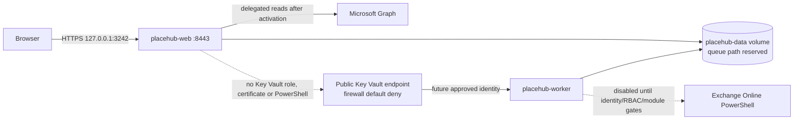

# Local Docker Compose Live-First environment

## Topology and boundaries



`placehub-web` and `placehub-worker` are different images and processes. Neither service mounts the Docker socket. The worker publishes no port. Port 3323 is intentionally not published because no authenticated diagnostics endpoint exists; container health checks are used instead.

## HTTPS certificate

Create a trusted development certificate outside the repository and export PEM files into an OS-ACL-protected directory. Example on a developer workstation:

```powershell
$tlsDirectory = Join-Path $env:LOCALAPPDATA 'PlaceHub/tls'
New-Item -ItemType Directory -Force -Path $tlsDirectory
dotnet dev-certs https --clean
dotnet dev-certs https --trust
dotnet dev-certs https -ep (Join-Path $tlsDirectory 'tls.crt') --format PEM --no-password
```

The export also creates `tls.key`. Restrict that file to the current user. Set `PLACEHUB_TLS_DIRECTORY` to this absolute directory. Compose mounts it read-only at `/run/placehub-tls`; neither file enters the image or repository.

## Configuration and startup

Normal startup is Live-First and deliberately fails until the required values exist:

```powershell
$env:PLACEHUB_TLS_DIRECTORY = "$env:LOCALAPPDATA\PlaceHub\tls"
$env:PLACEHUB_TENANT_ID = '<approved-tenant-guid>'
$env:PLACEHUB_CLIENT_ID = '<existing-placehub-frontend-client-guid>'
$env:PLACEHUB_WEB_CREDENTIAL_PROVIDER = '<approved-provider>'
$env:PLACEHUB_PERMISSIONS_APPROVED = 'false'
$env:PLACEHUB_CONSENT_VERIFIED = 'false'
$env:PLACEHUB_TENANT_CAPABILITY_VERIFIED = 'false'
docker compose config
docker compose build
docker compose up
```

Open `https://localhost:3242`. The exact Entra callback change to `https://localhost:3242/signin-oidc` and sign-out callback is prepared in `infrastructure/terraform/proposals/development-redirect-3242.json`; the active registration still uses port 8443 until separately applied.

For isolated synthetic tests only:

```powershell
docker compose -f compose.yaml -f compose.synthetic-test.yaml up --build
```

This override does not authorize deployment and must contain no live tenant IDs or credentials.

## Worker and Key Vault status

The worker service is structurally isolated and disabled. It emits only stable boundary codes:

- `WORKER_DISABLED`
- `NETWORK_PATH_UNAVAILABLE`
- `CREDENTIAL_BOOTSTRAP_REQUIRED`
- `PRIVILEGED_EXECUTION_NOT_ACTIVATED`

The Key Vault uses its public Azure endpoint, but the approved Terraform target must use `network_acls.default_action = Deny` and allow only a confirmed stable worker egress IPv4 CIDR. Public access does not mean all networks. No private endpoint or VPN is required by this revised design. The worker still needs a separately approved Azure authentication bootstrap and `Key Vault Secrets User`; local Docker has no Managed Identity.

PowerShell 7, the exact ExchangeOnlineManagement module and live certificate retrieval are not installed in the current worker image. Privileged execution remains disabled until versions, identity, RBAC, certificate handling and negative tests are approved.

## Queue limitation

The named Docker volume is local to one Docker host and may later contain the accepted SQLite database. The repository does not yet reference a SQLite provider, so requests are still in-memory and no durable/cross-process guarantee is claimed. Add a controlled SQLite provider/migration and WAL/busy-timeout/transaction/lease tests before enabling worker processing. Do not place the database on NFS, SMB or another network filesystem.

## Recovery and diagnostics

- Restarting the current web container loses in-memory requests.
- The disabled worker's health check proves only that the process boundary initialized—not Key Vault, Exchange or queue readiness.
- Use `docker compose logs placehub-web` and `docker compose logs placehub-worker`; logs contain stable codes only.
- Never print Compose environment, tokens, certificate content, private-key paths, Graph payloads or raw PowerShell streams in support records.
