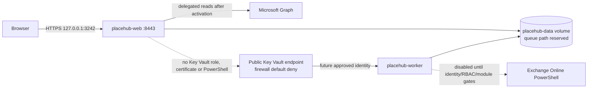

# Local Docker Compose Live-First environment

## Topology and boundaries



`placehub-web` and `placehub-worker` are different images and processes. Neither service mounts the Docker socket. The worker publishes no port. Port 3323 is intentionally not published because no authenticated diagnostics endpoint exists; container health checks are used instead.

## HTTPS certificate

Create a development certificate outside the repository and export PEM files into an OS-ACL-protected directory. The initializer refuses to overwrite existing certificate material and does not print private-key content:

```powershell
./scripts/Initialize-LocalTls.ps1 -WhatIf
./scripts/Initialize-LocalTls.ps1 -Trust
```

When `.env` contains `PLACEHUB_TLS_DIRECTORY`, the initializer uses that directory automatically. An explicit `-OutputDirectory` takes precedence. The directory value and private-key material are not written to the log.

The export also creates `tls.key`. Restrict that file to the current user. Set `PLACEHUB_TLS_DIRECTORY` to this absolute directory. Compose mounts it read-only at `/run/placehub-tls`; neither file enters the image or repository.

## Configuration and startup

Normal startup is Live-First and deliberately fails until the required values exist:

```powershell
$env:PLACEHUB_TLS_DIRECTORY = "$env:LOCALAPPDATA\PlaceHub\tls"
$env:PLACEHUB_TENANT_ID = '<approved-tenant-guid>'
$env:PLACEHUB_CLIENT_ID = '<existing-placehub-frontend-client-guid>'
./scripts/Initialize-LocalEntraCertificate.ps1 -WhatIf
./scripts/Initialize-LocalEntraCertificate.ps1
# Register only client-auth.cer on the existing Entra web application after approval.
# Keep client-auth.pfx local and never upload or commit it.
docker compose config
docker compose build
docker compose up
```

If Docker Desktop shows `3242:8443` but the container is stopped, the port mapping exists but cannot accept connections. Check `docker compose logs placehub-web`. `Could not find file '/run/placehub-tls/tls.crt'` means `PLACEHUB_TLS_DIRECTORY` points to a directory without the generated `tls.crt` and `tls.key`; initialize TLS and recreate the container.

The repository `.dockerignore` excludes host `bin` and `obj` directories. This is required for cross-platform builds: copying a Windows-generated `project.assets.json` into the Linux build stage would retain Windows-only NuGet fallback paths and make `dotnet publish` fail. It also excludes local certificate and environment-secret files from the Docker build context.

Open `https://localhost:3242`. Terraform now declares the exact `3242` sign-in/sign-out callbacks while preserving the existing `8443` sign-in redirect. The read-only tenant audit on 2026-11-01 found both sign-in redirects, but Terraform state reconciliation and any apply remain subject to ADR-016.

Normal runtime also requires an explicitly approved Enterprise Application role and an exact server-side location mapping. Put `PLACEHUB_USER_OBJECT_ID=<approved-signed-in-user-object-id>` and `PLACEHUB_LOCATION_PLACE_ID=<building-place-id>` into the untracked `.env`; Compose maps them to the server-side authorization configuration. A group may receive the Enterprise Application role, but location mapping remains bound to the resulting signed-in user's `oid`. Missing values become the nonmatching `UNASSIGNED` sentinel and never grant all locations. Configuration flags cannot assert consent or successful connectivity; the UI changes to a verified Graph state only after an actual delegated API response succeeds.

For isolated synthetic tests only:

```powershell
docker compose -f compose.yaml -f compose.synthetic-test.yaml up --build
```

This override does not authorize deployment and must contain no live tenant IDs or credentials.

## Worker and Key Vault status

The worker service is structurally isolated and disabled. It emits only stable boundary codes:

- `WORKER_DISABLED`
- `NETWORK_PATH_UNAVAILABLE`
- `CREDENTIAL_BOOTSTRAP_REQUIRED`
- `PRIVILEGED_EXECUTION_NOT_ACTIVATED`

The Key Vault uses its public Azure endpoint, but the approved Terraform target must use `network_acls.default_action = Deny` and allow only a confirmed stable worker egress IPv4 CIDR. Public access does not mean all networks. No private endpoint or VPN is required by this revised design. The worker still needs a separately approved Azure authentication bootstrap and `Key Vault Secrets User`; local Docker has no Managed Identity.

PowerShell 7, the exact ExchangeOnlineManagement module and live certificate retrieval are not installed in the current worker image. Privileged execution remains disabled until versions, identity, RBAC, certificate handling and negative tests are approved.

## Queue limitation

The named Docker volume is local to one Docker host and may later contain the accepted SQLite database. The repository does not yet reference a SQLite provider, so requests are still in-memory and no durable/cross-process guarantee is claimed. Add a controlled SQLite provider/migration and WAL/busy-timeout/transaction/lease tests before enabling worker processing. Do not place the database on NFS, SMB or another network filesystem.

## Recovery and diagnostics

- Restarting the current web container loses in-memory requests.
- The disabled worker's health check proves only that the process boundary initialized—not Key Vault, Exchange or queue readiness.
- Use `docker compose logs placehub-web` and `docker compose logs placehub-worker`; logs contain stable codes only.
- Never print Compose environment, tokens, certificate content, private-key paths, Graph payloads or raw PowerShell streams in support records.
