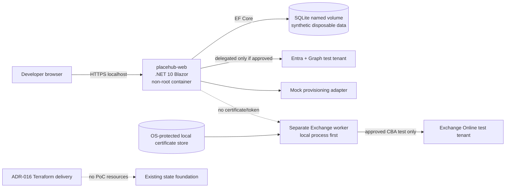

# Local-first Docker proof-of-concept architecture

**Status:** Accepted initial-PoC architecture baseline; no implementation, tenant permission, infrastructure or deployment is authorized.

**Date:** 2026-10-31

## Proposal and binding cost constraint

The initial PlaceHub PoC runs locally with Docker Compose and creates **zero incremental Azure cost**. It provisions no Azure resource and does not use an Azure free tier as a hosting substitute. ADR-016 remains intact but does not provision PoC application infrastructure. Its existing Blob remote-state storage may continue to incur already-established charges; local hosting does not remove them.

The application is one Linux-compatible .NET 10 ASP.NET Core Blazor modular-monolith image. SQLite stores only synthetic, disposable data in a named volume. Microsoft 365 operations are mocked by default; approved test-tenant procedures remain separately authorized.

## Topology

Initial Compose contains only `placehub-web` and its SQLite volume. The mock adapter cannot execute PowerShell. The Exchange worker stays outside Compose until its Windows-versus-Linux proof is approved and never shares the web container's filesystem, process namespace or credentials.

## Image and Compose design

Use a multi-stage Dockerfile: restore/build/test/publish from a pinned .NET 10 SDK image, then copy only published output into a pinned ASP.NET Core 10 runtime image. Run as the built-in non-root `app` user on port 8080. Runtime contains no SDK, source, Docker CLI, PowerShell, Exchange module, development certificate or package cache. Pin base-image digests during implementation review and rebuild for security updates.

Compose baseline:

- bind the web port to loopback only;
- read-only root filesystem with explicit temporary/data mounts;
- drop all capabilities and enable `no-new-privileges`;
- no privileged/host PID/host network mode, Docker socket, host certificate-store or arbitrary host-path mount;
- named volume mounted only at an application-owned data directory;
- liveness exposes no dependency/configuration detail; readiness checks initialized local dependencies but never mutates Microsoft 365;
- bounded CPU/memory/PID limits where supported;
- version-plus-source-revision image tags, never `latest`.

Hot reload, source mounts and mock tools belong in development-only overrides/profiles, not the deployable image.

## Configuration, identity and secrets

ASP.NET Core typed options form the stable contract. Domain/Application depend on ports, not Azure SDKs, Docker APIs or environment-variable names.

| Concern | Local source | Future host |
|---|---|---|
| Non-secret settings | checked-in defaults plus Compose environment | host configuration |
| Entra metadata | environment tenant/client IDs and exact URI | host settings |
| Developer secret | .NET user-secrets or approved local secret manager | approved provider adapter |
| Runtime identity | local developer/test implementation | managed/workload identity adapter after approval |
| Exchange certificate | never available to web; worker OS store | approved worker store/Key Vault after cost approval |

Never pass secrets in build arguments, image layers, committed Compose, commands or `.env`. The existing `.env` is Terraform bootstrap configuration, not an application-secret store. File-backed Compose secrets still require an untracked, OS-ACL-protected source.

Register exact fixed HTTPS loopback callbacks such as `https://localhost:<fixed-port>/signin-oidc` and `/signout-callback-oidc`; no wildcards or dynamic ranges. Browser TLS and Exchange CBA certificates are unrelated. Validate tenant, issuer, audience, nonce/state; retain tokens server-side and enforce role plus location on every use case.

Default runs use mocks. Live Graph tests require separately approved least-privilege delegated permissions. No container receives `Exchange.ManageAsApp`, an Exchange private key or the Terraform identity.

## SQLite lifecycle and migration

Store `/var/lib/placehub/placehub-poc.db` (configurable) in a named volume owned by the non-root UID. Never bake, bind to source, commit, artifact or log it. It contains no production visitor, employee, calendar or sensitive business data. One replica owns the file; scale-out and network filesystems are prohibited.

EF Core migrations are the schema source. A controlled one-shot migration profile runs before readiness; do not mix `EnsureCreated` with migrations or migrate silently on every startup. Serialize migrations and detect pending model changes in CI. An abandoned SQLite `__EFMigrationsLock` requires documented operator recovery plus integrity verification.

Synthetic seed data is deterministic, fake and idempotent. Reset stops the web service, deletes only the exact project volume after confirmation, migrates and reseeds. A volume is not a backup.

SQLite is behind application/repository ports. Migration to SQL Server/PostgreSQL requires provider selection, schema/type/concurrency changes, target migrations, data transformation, invariant checks and rehearsed cutover/rollback. The volume does not migrate automatically to App Service.

## Exchange worker assessment

| Candidate | Assessment |
|---|---|
| Hardened Windows local process | Direct CSP/`AT_KEYEXCHANGE` store support and ACLs. **Preferred first proof**, outside Docker. |
| Linux worker container | Reproducible and supported PowerShell/Linux combinations exist, but CSP-origin PFX import, module/native dependencies, isolation and secret injection need proof. Defer until Windows proof. |
| Worker in web container | Rejected: shares web compromise boundary and administrative material. |

The PoC initially mocks administration. An approved live test starts the worker for one bounded operation using the typed allowlist, CBA, idempotency, verification and teardown in [Exchange provisioning architecture](exchange-provisioning-architecture.md) and [certificate lifecycle runbook](exchange-certificate-lifecycle-runbook.md). Never mount the Docker socket or host certificate store into `placehub-web`.

## Logging and operations

Write structured stdout/stderr logs containing only timestamp, severity, correlation ID, component, operation category and stable outcome. Never render tokens, cookies, authorization headers, PII, calendar/SQLite content, connection strings, certificate/private material, environment dumps, raw Graph/PowerShell output or payload-bearing exceptions.

No Azure Monitor, Log Analytics or Application Insights is provisioned. Optional OpenTelemetry is local-only, loopback-bound and synthetic/sanitized. Logs have short local retention. Runbooks cover build/start/stop, health/readiness, migrations, seed/reset, volume identity/integrity, safe diagnostics, image updates and confirmed teardown.

## Alternatives matrix

| Criterion | Local Compose — initial | App Service container — future | Dedicated on-premises |
|---|---|---|---|
| Azure cost | Zero incremental; local cost remains. | Plan/registry/network/monitoring can cost money. | Organizational compute/labor remains. |
| Persistence | Disposable volume SQLite, one replica. | `/home` needs configuration; SQLite not approved for scale/production. | Internally operated storage/database. |
| Identity | Exact localhost OIDC; no managed identity. | Managed identity possible after approval. | Internally operated workload identity. |
| Worker | Separate local process first. | Separate compute likely required. | Hardened Windows worker candidate. |
| Operations | Workstation lifecycle; no SLA. | Managed features by paid tier. | Internal patching/backup/on-call. |
| Migration | Portable image/config contracts. | Image may be reusable after checks; Compose/data/secrets do not migrate. | Same image or separately approved IIS. |

Kubernetes is excluded without demonstrated orchestration needs.

## Cloud portability

The image must not assume Compose DNS, writable image root, local certificate store, SQLite path, development TLS termination or local user identity. Before App Service, verify architecture, port/startup, health, forwarded headers, TLS termination, Data Protection keys, redirect URIs, managed identity/secret adapters, egress, logs, registry/provenance and database migration.

Deploy one web image, not the local Compose topology. Microsoft's legacy App Service Docker Compose feature is being retired; a future design uses the supported container/sidecar model then current. Application deployment remains separate from ADR-016 Terraform provisioning and needs its own artifact identity, approvals and rollback.

## Zero-cost guardrails

Initial reviews/static policy reject App Service/Plan, ACR, Functions, Container Apps, Key Vault, Azure SQL/PostgreSQL, Monitor/Log Analytics/Application Insights, VNet/private endpoint, VM/managed compute, application Storage and any Terraform `resource` for PoC application infrastructure. Terraform apply is not local setup. Existing ADR-016 resources are neither recreated, changed nor removed.

## Risks, verification and backlog

Risks include Docker-host/root access to volumes/secrets, unsafe localhost OIDC shortcuts, SQLite corruption/lock/disk loss, debugger/log disclosure, independently unauthorized test-tenant mutation, vulnerable dependencies/images, mocks drifting from Microsoft services, possible key export during approved certificate transfer/future Key Vault use, and assuming image portability includes data/identity/secrets.

Required checks cover deterministic image build, non-root/minimal runtime, SBOM/vulnerability threshold, hardened Compose assertions, health/restart/shutdown, SQLite migrations/locks/disk/corruption/reset, exact OIDC callbacks and denial cases, offline retry/partial-failure mocks, secret/log canaries, no PoC Terraform resource and unchanged ADR-016 workflow.

Implementation-ready sequence:

1. Approve ADR-001/002/003/009/010/012/013/014/015 refinements, Docker assumptions, exact localhost URI and synthetic-data rule.
2. Create module skeleton and architecture tests.
3. Create secure multi-stage image plus scan/SBOM policy.
4. Create hardened Compose with one web service and named SQLite volume.
5. Add configuration, secret, identity and database abstractions without core Azure dependencies.
6. Add controlled migrations, seed/reset and recovery.
7. Add health/readiness and safe local observability.
8. Add deterministic mock Graph/provisioning adapters.
9. Separately approve local Entra redirect and test-tenant Graph validation.
10. Separately prove Windows Exchange worker; then evaluate Linux worker container.
11. Prepare App Service and database/identity/secret migration plan without deployment.

Any live Microsoft 365 call, Entra change, consent, Exchange certificate/permission/mailbox operation requires separate authorization. Any Azure resource or paid service requires Project Owner cost approval and revised ADR-013 approval.

## Official references

- [.NET containers and non-root user](https://learn.microsoft.com/dotnet/core/docker/introduction)
- [ASP.NET Core .NET 10 container builds](https://learn.microsoft.com/aspnet/core/host-and-deploy/docker/building-net-docker-images)
- [EF Core SQLite limitations](https://learn.microsoft.com/ef/core/providers/sqlite/limitations)
- [Applying EF Core migrations](https://learn.microsoft.com/ef/core/managing-schemas/migrations/applying)
- [App Service custom containers](https://learn.microsoft.com/azure/app-service/configure-custom-container)
- [Docker volumes](https://docs.docker.com/engine/storage/volumes/)
- [Docker Compose healthcheck](https://docs.docker.com/reference/compose-file/services/#healthcheck)
- [Docker Compose secrets](https://docs.docker.com/compose/how-tos/use-secrets/)

