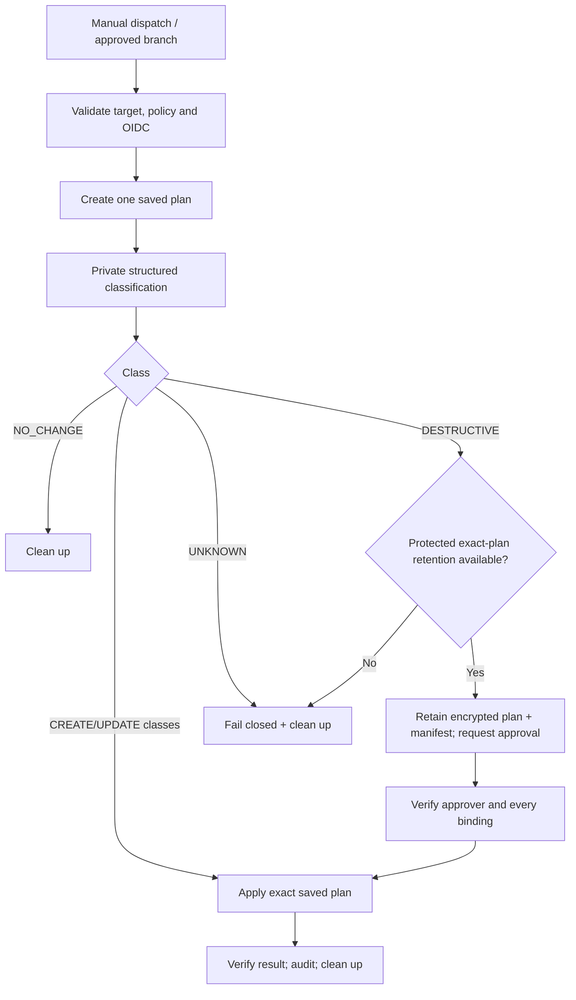

# Terraform non-destructive/destructive change governance

**Status:** Implementation specification for amended ADR-016; the current workflow has not implemented this model.

## Policy outcome

Inside a previously approved environment, resource allowlist and permission policy, create/update is normally authorized. Classifications are `NO_CHANGE`, `CREATE_ONLY`, `UPDATE_ONLY`, `CREATE_AND_UPDATE`, `DESTRUCTIVE_CHANGE` and `UNKNOWN_OR_UNVERIFIABLE`. Any deletion, replacement, access/credential/ownership removal, unmanaged/orphaned state or unverifiable effect requires exact-plan approval or fails closed.

This policy does not authorize Azure application resources for the local zero-cost PoC, production environment creation, new paid resource types, consent, directory roles, Exchange RBAC or broader deployment-identity permissions.

## Classification contract

Input is the byte-for-byte saved plan produced by the run plus expected bindings. The classifier invokes the pinned Terraform binary as `terraform show -json` and consumes stdout through a private pipe. It must not log the invocation, JSON, plan path or parser exception. No JSON file is necessary.

Validation order:

1. Verify repository, commit, branch, workflow, environment, tenant/subscription and configuration/provider-lock digest.
2. Parse one JSON document with bounded size/depth and reject duplicate/invalid members according to the selected parser policy.
3. Accept only a tested Terraform JSON major `format_version`; verify the expected Terraform version.
4. Reject unexpected root/module/resource/data/provider types and resources outside the versioned policy.
5. Normalize every managed `resource_changes[].change.actions` array. Unknown/missing/null/empty actions are unverifiable; `read` and `no-op` do not count as managed changes.
6. If any normalized action includes `delete`, return `DESTRUCTIVE_CHANGE` immediately.
7. Apply provider-semantic policy to before/after deltas without emitting their values. Any access/credential/owner removal or destructive field rule returns destructive; any unsupported/sensitive ambiguity returns unverifiable.
8. Return the non-destructive class from observed create/update flags, or `NO_CHANGE`.

Pseudo-code:

```text
if binding_invalid or format_unsupported or policy_target_unknown:
    UNKNOWN_OR_UNVERIFIABLE
for change in managed_resource_changes:
    actions = exact_validated_action_set(change)
    if "delete" in actions:
        DESTRUCTIVE_CHANGE
    if semantic_policy(change) == destructive:
        DESTRUCTIVE_CHANGE
    if semantic_policy(change) != safe:
        UNKNOWN_OR_UNVERIFIABLE
return class(create_seen, update_seen)
```

Only these exact action sets are initially understood: `no-op`, `read`, `create`, `update`, `delete`, `delete+create`, `create+delete`. Future values are unverifiable. Imports/moves require explicit policy fixtures even where no deletion is reported.

## Semantic policy registry

Each allowed Terraform resource type has a reviewed rule containing:

- permitted environment/module/address patterns;
- allowed create/update fields;
- fields whose removal/reduction is destructive;
- ForceNew/replacement fixtures for the pinned provider schema;
- permission/owner/credential collection comparison rules;
- data-retention/recovery/encryption/network consequences;
- sensitive/unknown-value handling;
- cost classification and zero-cost-PoC allowance;
- owner, policy version and provider versions tested.

Default for an absent/incomplete rule is unverifiable. Global hard-deny rules cover state commands, destroy/replace/target flags, backend changes and PoC Azure application resources.

For access-bearing resources, set comparison treats removal of any normalized principal/role/scope/permission/credential/owner/federated-trust item as destructive. Addition inside the approved immutable policy may be non-destructive; addition outside policy is unauthorized/unverifiable, never automatically permitted.

## Binding manifest

The classifier emits only a non-sensitive canonical manifest:

```json
{
  "schema": "placehub.terraform-plan-binding/v1",
  "repository": "JoergBrors/PlaceHub",
  "commit_sha": "<full-sha>",
  "workflow_ref": "<path@sha>",
  "run_id": "<id>",
  "run_attempt": 1,
  "environment": "development",
  "terraform_version": "1.16.1",
  "provider_lock_sha256": "<digest>",
  "policy_version": "<immutable-version>",
  "classification": "CREATE_ONLY",
  "counts": { "create": 1, "update": 0, "delete": 0 },
  "plan_sha256": "<digest>",
  "created_at": "<UTC>",
  "expires_at": "<UTC>"
}
```

Canonical bytes are signed/attested by the trusted workflow identity. The manifest contains no resource addresses or values unless a later security review proves them non-sensitive. Apply verifies the signature/attestation, expiry, exact current run/approval linkage and every binding before comparing the plan digest.

## Workflow state machine



The non-destructive path should remain within one protected runner/job so no binary plan transfer is needed. The destructive path cannot be implemented merely by putting a later job behind a GitHub Environment: environment reviewers approve before the job starts, and a new job needs access to the exact earlier plan.

Until approved retention exists, `DESTRUCTIVE_CHANGE` exits before apply. Policy `2026-10-31.1` and `scripts/Classify-TerraformPlan.ps1` implement the verified non-destructive path for `development`: the classifier reads the saved plan in memory, validates the pinned format/tool version and exact resource semantics, and the workflow reapplies only the same digest-verified file in the same job. `UNKNOWN_OR_UNVERIFIABLE` fails the run. This does not enable destructive apply or any other environment.

For a pure create, AzureAD legitimately marks provider-generated output metadata such as object/client IDs as unknown until apply. The classifier permits unknowns only for an explicit resource-type-specific computed-output allowlist after every policy-bearing input has matched exactly. Unknown owner, role, redirect, permission, credential or other unlisted fields fail closed. Any unknown value on an update remains `UNKNOWN_OR_UNVERIFIABLE`.

### Approved development inventory — policy `2026-10-31.1`

| Terraform address | Entra object | Approved configuration |
|---|---|---|
| `azuread_application.placehub_web` | `placehub-frontend-development` | Single tenant; Web platform; exact `https://localhost:8443/signin-oidc`; fixed sign-out callback; no implicit flow; three committed user-role IDs; no Graph permission declaration. |
| `azuread_service_principal.placehub_web` | Associated enterprise application | Assignment required; Terraform deployment principal recorded as owner; no credential or app-role assignment. |
| `azuread_application.m365_provisioning` | `placehub-m365-provisioning-development` | Single tenant; no redirect URI, permission, credential or certificate. |
| `azuread_service_principal.m365_provisioning` | Associated enterprise application | Assignment required; Terraform deployment principal recorded as owner; no effective access grant. |

All other managed addresses and resource types are rejected. In particular, the policy permits no `azurerm_*` application resource, paid service, password, certificate, federated credential, permission grant, consent, role assignment or Exchange configuration. Public certificate metadata can be added only after certificate enrollment and its immutable metadata are separately approved.

## Protected destructive-plan retention requirements

A candidate mechanism must satisfy all of the following:

- encryption at rest and in transit with a key unavailable to unapproved jobs/users;
- per-run least-privilege write/read identities and no repository-wide artifact read;
- immutable plan and canonical manifest with plan SHA-256 and attestation/signature;
- exact commit, workflow, run/attempt, environment, tool/provider and policy binding;
- short expiry/retention, single-use/replay prevention and audited access/approval;
- cleanup on approve/reject/timeout/failure plus lifecycle backstop;
- no plan/JSON/state in GitHub logs, job summaries, caches or ordinary artifacts;
- restore/download directly into a protected runner temporary directory;
- independent penetration/negative tests for substitution, rollback, cross-environment read and fork/PR access.

If no candidate meets these controls, use a separately approved execution service or manual recovery process; do not weaken plan confidentiality.

## Approval record

The destructive approver sees the non-sensitive manifest classification/counts/digests and the reviewed source revision/policy checks. The record binds approver identity, timestamp, change/ticket reference, manifest digest and decision. Prevent self-review and bypass where supported. Approval expires with the plan and cannot be reused.

Human approval does not make an unapproved resource, permission or environment valid. Policy checks run before approval and again before apply.

## Entra application-management boundary

Candidate Terraform-owned objects:

- approved PlaceHub application registrations and service principals;
- exact owners established through an administrator bootstrap;
- display/identifier metadata, app roles and exact local/future redirect URIs;
- public certificate/federated credential metadata where its lifecycle policy permits;
- declared `required_resource_access` entries from an immutable allowlist.

Not routine Terraform create/update authority:

- Graph admin or delegated consent;
- service-principal app-role assignment unless a separately approved effective-grant policy and narrow technical mechanism exists;
- Entra directory roles or Exchange RBAC;
- private keys/PFX/client secrets;
- deleting credentials, owners, permission assignments, apps or service principals.

AzureAD provider 3.10.0 documents `Application.ReadWrite.OwnedBy` for both approved resource types when the Terraform principal is an owner. Microsoft Graph documents that adding an application or service-principal owner can additionally require `Directory.Read.All`. Therefore the initial ownership bootstrap is an independent administrator operation: grant/admin-consent only the approved Terraform application permission, establish and verify ownership as a separately audited step where required, then run plan. Do not silently add `Directory.Read.All`; stop and obtain a specific permission approval if provider execution proves it necessary. Provider operations that require `Application.ReadWrite.All` remain blocked pending a security amendment. `AppRoleAssignment.ReadWrite.All` is not approved.

## Privilege-escalation assessment

Primary attack paths and controls:

| Risk | Control |
|---|---|
| Malicious code adds powerful permission declaration | Immutable permission allowlist, CODEOWNERS, static policy; declaration is not consent. |
| Deployment identity grants itself/another app effective privilege | No general app-role assignment permission; separate admin process. |
| Owned-object credential addition creates persistence | Credential types/names/issuer/subject policy; removal destructive; addition requires approved lifecycle. |
| Classifier bypass via unknown action/schema/provider | Unknown fails closed; pinned versions and adversarial fixtures. |
| Update hides access/data removal | Semantic before/after rules; unsupported sensitive delta unverifiable. |
| Plan substitution after approval | Signed manifest, plan hash, exact bindings, single-use expiry. |
| State removal bypasses plan deletion | State commands unavailable; workflow/permissions/policy scan; audited recovery only. |
| Fork/PR exfiltrates sensitive plan | No artifact/log; protected environment/branch; retention identity inaccessible to untrusted events. |

## Test specification

Unit fixtures must cover no-op/read, create, update, create+update, delete, both replacement orders, mixed delete plus ordinary action, import/move, unknown action, unsupported major/minor handling policy, malformed/truncated/oversized JSON, null/missing fields and duplicate records.

Semantic fixtures cover role assignment removal, list-member removal, credential/federated-credential removal, owner reduction, retention/recovery weakening, destructive provider update, sensitive unknown delta and permission outside allowlist.

Workflow tests cover wrong repo/branch/environment/tenant/subscription, unapproved resource/cost, stale policy, plan/manifest substitution, wrong commit/run/attempt, expired/replayed approval, tampered digest/signature, missing retention, cancellation cleanup and OIDC mismatch.

Logging tests inject canaries into plan variables, before/after values, addresses, identifiers, parser failures and temporary paths and assert absence from every log/summary/artifact. Apply tests use a synthetic provider/local harness only; no live Azure/Entra mutations are required.

## Implementation gates

1. Approve classifier language/parser and semantic-policy ownership.
2. Add provider schema/plan fixtures without adding infrastructure resources.
3. Approve branch/CODEOWNERS/status protections.
4. Prove Entra owned-object provider operations before any Graph permission grant.
5. Select and security-test protected plan retention or retain fail-closed destructive behavior.
6. Approve workflow implementation in a separate task; then verify exact-plan apply synthetically.
7. Separately approve every production boundary and destructive plan.

## References

- [Terraform JSON output format](https://developer.hashicorp.com/terraform/internals/json-format)
- [`terraform show -json` sensitive-data warning](https://developer.hashicorp.com/terraform/cli/commands/show)
- [Terraform saved plans](https://developer.hashicorp.com/terraform/cli/commands/plan)
- [Terraform apply saved-plan mode](https://developer.hashicorp.com/terraform/cli/commands/apply)
- [GitHub environments and required reviewers](https://docs.github.com/en/actions/reference/workflows-and-actions/deployments-and-environments)

