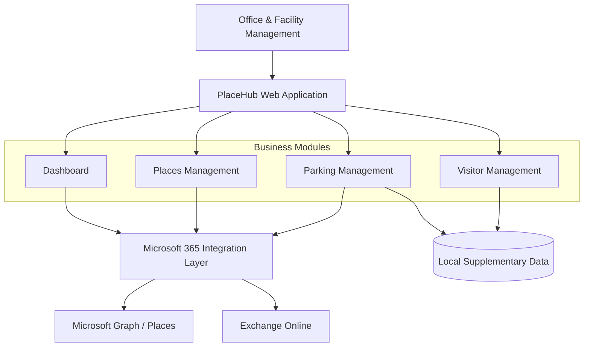

# 🏢 PlaceHub
### One Workplace. One Dashboard. Zero Microsoft 365 Admin Complexity.

**The lightweight, Microsoft 365-native command center for modern Office & Workplace Management.**

> **Stop switching between admin portals. Start managing your workplace.**
>
> PlaceHub brings Microsoft Places, Exchange Online parking resources, and visitor management together in one intuitive interface — built for Office Managers, not Microsoft 365 administrators.

The repository includes a local, offline .NET 10 Blazor proof of concept for UI-driven desk-pool and parking-resource administration. It performs no Microsoft 365 or Azure mutation. Run it with `dotnet run --project src/PlaceHub.Web` and validate it with `dotnet test PlaceHub.slnx`. See [UI-driven resource administration](Docs/ui-driven-resource-administration.md).

The responsive enterprise shell, design tokens, booking calendar and accessibility conventions are documented in [UI design system](Docs/ui-design-system.md).

Microsoft 365 Phase-2 adapters remain offline by default. Their supported read-only capabilities, permission matrix and activation gates are documented in [Microsoft 365 read-only readiness](Docs/microsoft365-readonly-readiness.md).

The Phase-3 Office Management dashboard exposes authorized local mock requests at **Meine Aufträge**. Durable queue and isolated worker implementation are intentionally blocked pending the proposed [ADR-017](Docs/Adr/ADR-017-durable-provisioning-queue-and-worker-contract.md) and ADR-015 approval; see [Phase 3 readiness](Docs/phase3-worker-queue-readiness.md).

## VS Code debugging

Open the repository root in VS Code, select **Run and Debug**, then start **PlaceHub Web (Development)** with `F5`. The browser opens the desk-pool page at `http://localhost:5000`. **PlaceHub Web (Production assets)** runs the regression-relevant Production configuration on port `5001`. Build, test and watch tasks are available through **Terminal → Run Task**.

---

## 🚀 Why PlaceHub?

Managing a modern office shouldn't require navigating multiple administration portals, understanding PowerShell, or holding elevated Microsoft 365 permissions.

Yet everyday workplace operations are often scattered across different tools.

- 🏢 **Buildings and floors** are managed through Microsoft Places administration.
- 🪑 **Workspaces and desk pools** require an understanding of Microsoft 365 resource structures.
- 🚗 **Parking spaces** need availability tracking and reservation management.
- 👋 **Visitors** require scheduling, coordination, and potentially parking.
- 📊 **Office Managers** need one operational overview instead of disconnected administration screens.

**PlaceHub is designed to bring these workflows together.**

Not another Microsoft 365 replacement.

Not another oversized facility management suite.

**Just the workplace management capabilities Office Management actually needs.**

---

## ✨ The Vision

Imagine opening one dashboard and immediately knowing:

- How many workplaces are available?
- Which parking spaces are reserved today?
- Which visitors are expected?
- What buildings, floors, and workspaces are managed?
- Which upcoming reservations require attention?
- Are there any operational issues?

All in one place.

All behind a simple, business-friendly interface.

**Powered by Microsoft 365. Designed for people.**

---

## 🧩 Planned Features

### 🏢 Microsoft Places Management

Manage workplace structures without exposing users to unnecessary technical complexity.

**Planned capabilities:**

- Browse buildings, floors, and sections.
- View workplace and desk pool structures.
- Create and update supported Places objects.
- Manage workplace capacities and associations.
- Display location-specific operational information.
- Integrate existing Microsoft Places resources.

**Design principle:** Microsoft Places remains the authoritative source for workplace structures.

The actual implementation of management operations depends on supported Microsoft Graph and Microsoft Places administration interfaces.

### 🚗 Smart Parking Management

**What if every parking space could use the booking capabilities already available in Exchange Online?**

That's the core idea behind PlaceHub Parking.

Instead of building an independent reservation engine, the proposed design represents parking spaces through Exchange Online resource mailboxes.

**Planned capabilities:**

- Register and manage parking spaces.
- Associate parking spaces with buildings.
- Organize spaces by parking area.
- Support attributes such as EV charging and accessibility.
- Check availability through Microsoft 365 calendars.
- Request and cancel reservations.
- Assign parking to employees or visitors.
- Display booking conflicts and reservation status.

**Example parking resource:**

| Property | Value |
|---|---|
| Parking Space | P-017 |
| Building | Headquarters |
| Area | Underground Garage |
| Features | EV Charging |
| Booking Backend | Exchange Online |
| Resource Type | Equipment Mailbox (proposed) |

The final mailbox type and reservation workflow must be validated against Exchange Online capabilities.

**One parking resource. One Exchange calendar. No competing booking database.**

### 👋 Visitor Management

Make welcoming visitors easier without introducing a full enterprise visitor management platform.

**Planned capabilities:**

- Register visitors and scheduled visits.
- Select buildings and arrival times.
- Assign internal hosts.
- Display daily visitor schedules.
- Modify or cancel visits.
- Optionally support check-in and check-out.
- Optionally coordinate visitor parking.

Visitor records are not automatically Microsoft Entra B2B guest accounts.

Where no suitable native Microsoft Places interface exists, PlaceHub may use a lightweight visitor management module with appropriate privacy and retention controls.

### 📊 Office Operations Dashboard

**Know what's happening before someone asks.**

The planned dashboard brings together essential operational information:

| Area | Planned Overview |
|---|---|
| Buildings | Managed locations and structures |
| Workspaces | Capacity and supported availability information |
| Parking | Spaces, availability, and reservations |
| Visitors | Expected arrivals and visit schedules |
| Operations | Upcoming activities and exceptions |
| Administration | Integration and configuration warnings |

Filters by location and date help Office Management focus on relevant information.

Dashboard metrics will only be implemented where reliable and appropriately authorized data sources exist.

---

## 🎯 Who Is PlaceHub For?

**Office Managers** who need a central interface for everyday workplace operations without becoming Microsoft 365 administrators.

**Facility Management Teams** responsible for workplace structures, parking resources, and location-specific administration.

**IT Administrators** who want to delegate routine Office Management activities securely without granting unnecessary tenant-wide privileges.

**Organizations using Microsoft 365** that prefer to build on existing infrastructure rather than immediately introduce another independent workplace platform.

---

## 🏗️ Architecture Vision

PlaceHub is planned as a pragmatic enterprise application built around **.NET 10 LTS**.

### Proposed Technology Stack

| Layer | Proposed Technology |
|---|---|
| Application | ASP.NET Core / .NET 10 LTS |
| Frontend | Blazor Web App |
| Architecture | Modular Monolith |
| Identity | Microsoft Entra ID |
| Workplace Integration | Microsoft Places / Microsoft Graph |
| Parking Backend | Exchange Online Resource Mailboxes |
| Data Access | Microsoft Graph SDK and supported administration interfaces |
| Persistence | EF Core with relational database, if required |
| Hosting | Azure App Service or on-premises |
| Observability | Structured logging and tracing |

These are architectural proposals, not approved implementation decisions.

### Conceptual Architecture

Conceptual only. Authentication, authorization, privileged provisioning, and operational controls are intentionally simplified in this overview.

### Microsoft 365 Is the Source of Truth

PlaceHub follows one fundamental principle:

**Use Microsoft 365 capabilities wherever they are supported. Do not rebuild them unnecessarily.**

Microsoft Places owns workplace structures.

Exchange Online owns parking reservation calendars and booking decisions.

PlaceHub owns only the supplementary application data and workflows it actually needs.

---

## 🔐 Security by Design

PlaceHub is intended to support secure delegation of business operations.

The planned security model includes:

- Microsoft Entra ID authentication and SSO.
- Role-based and location-specific authorization.
- Least-privilege Microsoft Graph and Exchange permissions.
- Server-side handling of access tokens.
- Auditing of administrative operations.
- Separation of everyday management and privileged provisioning.
- Privacy-by-design for personal visitor information.
- No unnecessary tenant-wide administrator permissions.

**Office Managers should manage offices — not Microsoft 365 tenant security.**

---

## ⚖️ Why Not Just Use Existing Tools?

Microsoft Places already provides workplace functionality. Enterprise platforms such as Robin, Envoy, and Eptura provide broader workplace and visitor management capabilities.

PlaceHub is not intended to replicate every feature of those platforms.

Its proposed differentiation is narrower:

| Approach | PlaceHub Position |
|---|---|
| Microsoft Places Administration | Complement with simplified office operations |
| Exchange Resource Calendars | Reuse as parking booking infrastructure |
| Enterprise Workplace Platforms | Focus on a deliberately smaller scope |
| Custom Booking Platform | Avoid duplicating existing Exchange capabilities |
| Full Microsoft 365 Admin Portal | Do not recreate it |

### The Opportunity

PlaceHub may be particularly useful for organizations that:

- Already rely on Microsoft 365.
- Want a lightweight internal Office Management tool.
- Need combined workplace, parking, and visitor workflows.
- Prefer minimal additional infrastructure.
- Want technical administration separated from business operations.

This positioning is a project hypothesis, not a validated claim of feature or cost superiority.

---

## 🗺️ Development Roadmap

### Phase 1 — Discovery & Feasibility

- Validate Microsoft Places APIs and hierarchy operations.
- Investigate Exchange resource mailbox booking behavior.
- Determine visitor management integration options.
- Verify licensing and permission requirements.
- Produce the Microsoft 365 Capability Matrix.

### Phase 2 — Architecture & ADR Approval

- Review the proposed Architecture Decision Records.
- Select the final frontend and application architecture.
- Define authentication and authorization.
- Validate persistence and integration decisions.
- Approve the MVP scope.

### Phase 3 — Technical Proof of Concept

- Read existing Places structures.
- Test supported Places administration operations.
- Read Exchange resource availability.
- Request and cancel parking reservations.
- Validate concurrent booking and failure scenarios.
- Verify least-privilege permissions.

### Phase 4 — Minimum Viable Product

**Proposed MVP scope:**

- Entra ID login.
- Central Office Management dashboard.
- Existing building and workplace hierarchy overview.
- Supported basic Places management.
- Parking inventory and availability.
- Parking reservation workflows.
- Basic visitor scheduling.

Feature inclusion depends on successful technical validation and architectural approval.

### Phase 5 — Operational Enhancements

Potential later improvements:

- Advanced parking administration.
- Visitor check-in and check-out.
- Location-specific reporting.
- Additional resource categories.
- More detailed operational diagnostics.

---

## 📐 Architecture Decision Records

PlaceHub follows a documentation-driven engineering process.

The current baseline accepts ADR-001, 002, 003, 009, 010, 012, 013, 014 and 016. ADR-004–008, 011 and 015 remain proposed pending Microsoft 365 capability, privacy, synchronization and privileged-operation decisions.

**The accepted application scope is a local Docker/SQLite PoC with zero incremental Azure cost. Permissions, tenant mutations, privileged Exchange execution, paid services and production remain separately gated. ADR-016 continues to govern Terraform delivery only.**

Before implementation, contributors must inspect existing repository documentation, review applicable ADRs, resolve conflicts, and validate relevant Microsoft 365 capabilities.

Current discovery documents: [ADR consistency audit](Docs/adr-consistency-audit.md), [local-first Docker PoC](Docs/local-first-poc-architecture.md), [infrastructure architecture](Docs/infrastructure-architecture-discovery.md), [Entra application and permission architecture](Docs/entra-application-permission-architecture.md), and [Exchange provisioning architecture](Docs/exchange-provisioning-architecture.md).

Terraform change authorization is defined in [amended ADR-016](Docs/Adr/ADR-016-github-actions-terraform-delivery.md) and the [change-governance specification](Docs/terraform-change-governance.md): approved in-boundary create/update is routine; deletion, replacement and access removal require explicit exact-plan approval.

The initial PoC is an architecture baseline, not an implemented application. No Azure application resource, live tenant permission or Exchange mutation is implied by these documents.

No undocumented architectural decisions should be introduced during implementation.

---

## 📚 Official Technology References

- [Microsoft Places documentation](https://learn.microsoft.com/en-us/microsoft-365/places/)
- [Microsoft Graph documentation](https://learn.microsoft.com/en-us/graph/overview)
- [Microsoft Graph Places API](https://learn.microsoft.com/en-us/graph/api/resources/place)
- [Microsoft Exchange Online](https://learn.microsoft.com/en-us/exchange/exchange-online)
- [Exchange Equipment Mailboxes](https://learn.microsoft.com/en-us/exchange/recipients/equipment-mailboxes)
- [Microsoft Entra ID](https://learn.microsoft.com/en-us/entra/identity/)
- [.NET 10](https://learn.microsoft.com/en-us/dotnet/core/whats-new/dotnet-10/overview)

These references are starting points for technical discovery. They do not imply that every planned PlaceHub operation is available through a supported API.

---

## 🧪 Project Status

**Current status: Architecture & Technical Discovery**

PlaceHub is currently a project concept with proposed architecture decisions.

The repository documentation defines the intended direction, not a claim of implemented or production-ready functionality.

Important technical assumptions — including Microsoft Places administration coverage, parking mailbox provisioning, Exchange booking behavior, API permissions, and licensing — require verification before implementation.

---

## 🤝 Engineering Philosophy

**Keep it simple. Keep it secure. Keep it Microsoft 365-native.**

We believe powerful enterprise software doesn't have to be complicated.

PlaceHub favors:

- Business value over feature count.
- Supported integrations over fragile workarounds.
- Modular architecture over unnecessary distributed systems.
- Clear authorization over excessive privileges.
- Microsoft 365 ownership over redundant master data.
- Verifiable engineering decisions over assumptions.
- Documentation and testing as part of delivery.

---

## 💡 The Big Idea

**Microsoft 365 already provides much of the infrastructure.**

PlaceHub aims to connect those capabilities through an experience designed specifically for the people managing offices every day.

Less portal hopping.

Less technical complexity.

More visibility.

Better workplace operations.

### PlaceHub — Your workplace. Simplified.

---

*PlaceHub is an independent project concept built around Microsoft 365 technologies. It is not presented as an official Microsoft product or as a production-ready application.*
